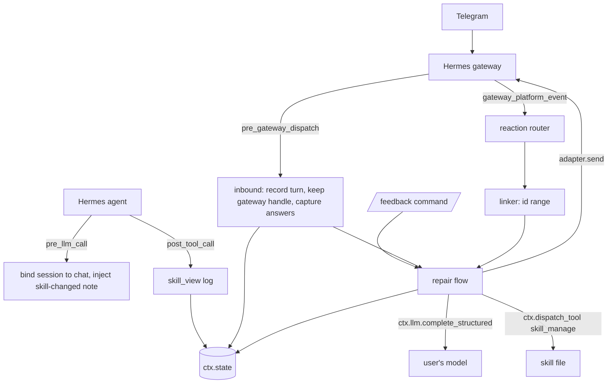

# Architecture: thumbs-fix

A Hermes Agent plugin. Thumbs-down a bad reply on Telegram and Hermes names the skill behind it, asks one question, shows a proposed edit as a diff, and changes the skill only after you approve.

## Core flow

1. The user sends a request in a private Telegram chat. The plugin records the inbound message id as a new **turn**.
2. The agent loads a skill with `skill_view`. The plugin adds that skill to the current turn.
3. The bot replies. Its message ids fall after that turn's inbound id.
4. The user reacts thumbs-down. The plugin finds the turn by **message id range** and opens a **repair**.
5. The plugin says which skill it was and asks "What was wrong?". The next text message is taken as the answer and never reaches the agent.
6. The plugin drafts a one-place edit with the user's own model, validates it, and sends a text diff.
7. Thumbs-up on the diff, or `/feedback approve`, applies it through `skill_manage`, after a backup.
8. The next turn in that chat is told the skill changed, so the agent re-reads it. The next report is right.

Anything that cannot be linked to one turn gets a polite refusal and changes nothing.

## Stack

Plain Python 3.11+ with no third-party runtime dependencies, tested with pytest. Requires Hermes `>=0.21.5`. See [ADR 0005](docs/adr/0005-no-dependencies-and-a-hermes-free-core.md).

## System sketch

Layout: `plugin.yaml` and `__init__.py` at the repo root, so `hermes plugins install owner/repo` works. `__init__.py` holds only `register(ctx)` and the guarded hook adapters. All logic lives in `core/` (`turns`, `linker`, `repairs`, `drafting`, `applying`, `commands`, `messages`), which imports nothing from Hermes and receives its boundary as small interfaces. Tests use fakes at that boundary.

Hooks: `pre_gateway_dispatch`, `pre_llm_call`, `post_tool_call`, `gateway_platform_event`. Command: `/feedback`. No tools, no middleware, no `requires_env`, no elevated capabilities.

## Data model

All in `ctx.state`, per profile, bounded.

- **Turn**: chat id, inbound message id, skills loaded, session id. Last 200 per chat.
- **Own message**: ids of messages the plugin sent, so reactions on them are never treated as bad replies.
- **Repair**: id, chat, turn, skill, state, the user's feedback, the draft (`old_string`, `new_string`, file hash), diff message id, backup path.
- Repair states: `awaiting-skill` (two skills), `awaiting-answer`, `drafting`, `awaiting-approval`, `applied`, `rejected`, `failed`.
- Backups: a copy of `SKILL.md` under the plugin data directory, one per applied repair.

## Must be real

Real Telegram reactions on a real bot. A live model call writes the diff. A real skill file changes after approval, and a second report shows it. Real refusals for unlinkable reactions, an empty queue and a model failure.

No exceptions recorded. The eval suite uses saved model responses so the tests are repeatable; the live path is `pytest -m live` and the demo itself.

## Known limits

Documented in the README.

- Private chats only, because groups share one id sequence across many people.
- A message sent while a turn is running skips `pre_gateway_dispatch` (a known Hermes gap), so it can merge two turns.
- After a gateway restart the plugin cannot reply until the user has sent one message, because the gateway handle arrives with the first inbound message. Repairs themselves survive.
- A skill loaded in an earlier turn of the same session may not be loaded again, so a later reply can show no skill behind it. The plugin refuses rather than guesses.
- Skills loaded by a subagent are not logged. Skills shipped inside plugins are read-only and cannot be repaired.

## Milestones

| # | Target (UTC) | What | |
| --- | --- | --- | --- |
| 1 | 05:00 | Walking skeleton: loads in real Hermes, a real reaction gets the named-skill question | |
| 2 | 11:00 | Full repair loop: answer, diff, approve or reject, apply, undo, restart | |
| 3 | 14:00 | Reliability pass, `validate` and `doctor` green, README, catalog entry | **deployed** |

"Deployed" means installable from the public GitHub repo with `hermes plugins install`. There is no server. The operator pushes the repo, opens the catalog pull request (one YAML file pinned to the final commit) and posts the demo video.

## Specialist review

None. Skill edits are consented, reversible and backed up.

## AI

The plugin uses whichever model Hermes is configured with. See [ADR 0003](docs/adr/0003-draft-edits-with-the-users-own-model.md). One call per repair, 30 s timeout, no retry, `max_tokens` 800. Output is schema-validated, and the plugin computes the diff itself. The user's feedback and the skill text are treated as untrusted data, and the only possible effect of the output is one proposed replacement inside one `SKILL.md`, which a person approves. `evals/` holds 10-15 cases of saved responses with expected properties, run by the test command.

## Commands

- Test: `python -m pytest -q`
- Live model evals: `python -m pytest -q -m live`
- Real-Hermes checks, in WSL: `hermes plugins doctor . --ci` and `hermes plugins validate . --install-deps`

## Event rules

MIT licence, public repo, all code written during the event. The organiser's prior-work and eligibility rules are unconfirmed.
