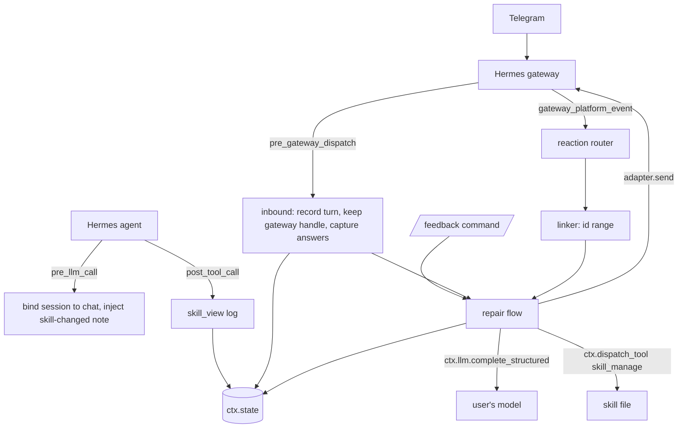

# thumbs-fix

Thumbs-down a bad Hermes reply on Telegram and Hermes names the skill behind it, asks one question, shows a proposed edit as a diff, and changes the skill only after you approve.

A [Hermes Agent](https://github.com/NousResearch/hermes-agent) plugin. MIT licensed. Requires Hermes 0.21.5 or newer.

> Built for the **Hermes Agent Plugin Hackathon** by Nous Research.

## Demo


https://github.com/user-attachments/assets/dfbdeed0-c78d-4326-91d2-868e180b41f8


A real run on Telegram with DeepSeek as the model: a wrong date format, a thumbs-down, one question, the diff, a thumbs-up, and the fixed reply. Click the image to play the video ([`docs/media/thumbs-fix-demo.mp4`](docs/media/thumbs-fix-demo.mp4)).

## The flow

1. You ask for something in a private Telegram chat with your Hermes bot. The agent loads a skill to answer.
2. The answer is wrong. You long-press it and react with a thumbs-down.
3. thumbs-fix finds the skill that was loaded for that reply, tells you its name and asks one question: "What was wrong?"
4. You answer in plain text. That message goes to the plugin, not to the agent.
5. Your own configured model drafts a one-place edit to that skill. The plugin checks the draft and computes a text diff itself.
6. You read the diff and react with a thumbs-up on it (or send `/feedback approve`). Nothing is changed before this.
7. The plugin backs up the skill, then applies the edit through Hermes' own `skill_manage`. The next turn in that chat is told the skill changed, so the agent re-reads it.

A thumbs-down on the diff, or `/feedback reject`, drops the draft and changes nothing. `/feedback undo` puts the backup back. `/feedback retry` asks the model for a new draft after a failed one. `/feedback` alone lists open repairs. If the plugin cannot tell which skill made a reply, it says so and changes nothing.

## Architecture



More detail, including the data model and the design decisions, is in [ARCHITECTURE.md](ARCHITECTURE.md) and `docs/adr/`.

## Install

```bash
hermes plugins install LikemDzokoto/thumbs-fix
hermes plugins enable thumbs-fix
```

Restart the gateway after enabling so it loads the plugin.

There is nothing to configure and no extra Python dependency.

## Telegram setup

The plugin works through the Hermes Telegram gateway. Create a bot with BotFather, put the token and your numeric user id into Hermes' own environment file yourself, and start the gateway. Step by step, including a check that reactions reach the plugin: [docs/live-setup.md](docs/live-setup.md).

## Hermes features used

- Four hooks: `pre_gateway_dispatch`, `pre_llm_call`, `post_tool_call`, `gateway_platform_event`.
- `ctx.llm.complete_structured`, for the draft, using the model you already configured.
- `ctx.dispatch_tool` with `skill_view` (read a skill before and after the edit) and `skill_manage` (create the demo skill, apply and undo an edit).
- `ctx.state`, for turns, repairs and message ids.
- `ctx.register_command`, for `/feedback`.
- The gateway adapter's `send`, to message you in the same chat.

It declares no tools, no middleware and no environment variables.

## Known limits

- **Private Telegram chats only.** Groups share one message id sequence across many people, so a reaction there is ignored.
- **The last turn's message id range has no upper end.** A reply is linked to a turn by message id range. A later unrelated bot message in the same chat (a cron delivery, a notification) is linked to the latest turn.
- **A skill loaded in an earlier turn of the same session is refused.** The agent may not load a skill again in a later turn, so that reply shows no skill behind it. The plugin refuses rather than guesses.
- **Staged edits are not tracked to Hermes `/skills` approval.** If your Hermes has `skills.write_approval` on, `skill_manage` only stages the edit. The plugin tells you it is staged, but it does not follow your approval in `/skills`, so it never records that repair as applied and `/feedback undo` has nothing to undo for it.
- **After a gateway restart there is no send handle** until you send one message. The gateway handle arrives with the first inbound message. Open repairs survive the restart.
- **`/feedback` from the CLI acts across chats.** In Telegram it acts on that chat. From the CLI there is no chat, so list, approve, reject and undo apply to repairs in any chat.
- **`skill_view` has side effects.** The plugin reads skills through `skill_view` to check them before applying, and Hermes may count those views.
- **Undo overwrites edits made after the repair.** `/feedback undo` restores the backup taken before the repair. Anything you or Hermes changed in that skill since is lost.
- Skills loaded by a subagent are not logged. Skills shipped inside plugins are read-only and cannot be repaired. A message you send while a turn is running skips `pre_gateway_dispatch` (a known Hermes gap), so it can merge two turns.

## Disclosure

What a user would want to know before installing.

**Hooks, and why each exists**

- `pre_gateway_dispatch`: records each private-chat message you send as a new turn, keeps the gateway handle used to message you back, and takes your answer to "What was wrong?" so it does not reach the agent. It does not drop or rewrite any other message.
- `pre_llm_call`: ties the agent's session to the chat, and adds one short note to the next turn after a repair is applied, saying which skill changed.
- `post_tool_call`: watches `skill_view` calls to record which skills were loaded during a turn. It looks at no other tool.
- `gateway_platform_event`: receives Telegram reactions: a thumbs-down on a reply opens a repair, a thumbs-up or thumbs-down on a diff approves or rejects it.

**What is stored, and where**

- In `ctx.state` (Hermes' per-profile plugin state): `turns` (chat id, your inbound message id, names of skills loaded, session id; last 200 per chat), `sessions` (session to chat), `senders` (whether a sender's last message was private), `repairs` (state, the skill name, your answer to "What was wrong?", the draft's old and new text, a file hash, ids of the diff messages, the backup path; last 100) and `own_messages` (ids of messages the plugin sent, so reactions on them are not mistaken for bad replies). All bounded. It does not store message text apart from your answer.
- In the plugin data directory (`$HERMES_HOME/plugin-data/thumbs-fix/backups/`): one copy of the skill's `SKILL.md` per applied repair, taken before the edit.
- Nothing else is written. No telemetry, no analytics, no network request of its own.

**It edits skills only after your explicit approval.** Nothing is written until you react with a thumbs-up on the diff or send `/feedback approve`. A thumbs-down, `/feedback reject`, or no answer at all changes nothing. If the skill changed since the diff was made, the edit is refused. The edit goes through Hermes' `skill_manage`, so Hermes' own validation, locking and security scan run. `/feedback demo` is the only other write: it creates a sample `weekly-report` skill, through `skill_manage`, and never overwrites an existing skill.

**It calls your own model.** One call per repair to `ctx.llm.complete_structured`, with the model Hermes is already configured to use (no provider or model override, 30 second timeout, no retry). The prompt contains the skill text and your answer, so both go to whichever provider your model uses. Your answer and the skill text are treated as untrusted data. The model's output is validated against a schema, can only propose one replacement inside one `SKILL.md`, and a person approves it.

**Reads outside its own data:** the `SKILL.md` of the skill being repaired (through `skill_view`, and for the hash check and exact-byte undo, from the skill's folder). It reads no credentials, no `.env`, starts no processes and runs no shell commands.

## How this differs from reaction-feedback and reaction-ledger

Two listed plugins already do something with Telegram reactions. [reaction-feedback](https://github.com/AhmetArif0/hermes-reaction-feedback) lets the agent see your reactions: it adds a short note to the agent's next turn saying you reacted with a thumbs-down to a message. [reaction-ledger](https://github.com/olric3015/hermes-plugins) keeps a local count of the reactions people leave, so you can ask how many of each there were. Both pass the signal along or count it, and neither changes anything. thumbs-fix uses the same reaction as an instruction to fix something: it works out which skill produced that reply, asks what was wrong, and, with your approval, edits that skill so the same mistake does not come back. It reuses none of their code; it keeps its own record of which messages belong to which turn.

## The demo in 7 steps

You need the Telegram setup above, with the gateway running and a private chat with your bot open.

1. Send `/feedback demo`. It creates a sample skill, `weekly-report`, that formats dates as MM/DD/YYYY.
2. Send "give me the weekly report". The dates come back as MM/DD/YYYY.
3. React to that reply with a thumbs-down.
4. The bot says the reply came from `weekly-report` and asks "What was wrong?". Answer "Dates should be DD/MM/YYYY".
5. The bot shows a diff of the skill. React to the diff with a thumbs-up.
6. The bot confirms the skill is changed and a backup is saved.
7. Send "give me the weekly report" again. The dates are DD/MM/YYYY. `/feedback undo` puts the skill back.

## Development

```bash
python -m pytest -q                 # tests, no Hermes needed
bash scripts/check-hermes.sh        # in WSL or Linux with Hermes installed: doctor, validate and the real-Hermes tests
```

The plugin logic is in `core/` and imports nothing from Hermes. See [ARCHITECTURE.md](ARCHITECTURE.md), [GLOSSARY.md](GLOSSARY.md) and `docs/adr/`.

## Licence

MIT. See [LICENSE](LICENSE).
